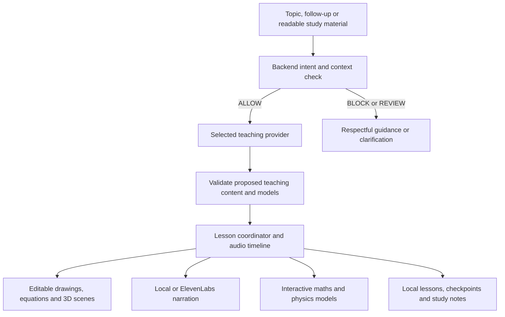

# Canvas Atlas

**A personal visual AI tutor that explains, draws and explores concepts with you—at your pace.**

Canvas Atlas helps students study independently with the feel of a teacher explaining at a whiteboard. Start with a topic or your own study material, hear an explanation, watch diagrams take shape, ask questions and explore interactive experiments. It is designed to complement teachers and classroom learning.

**Current version:** 0.7.0 · **Platform:** Windows desktop · **Teaching connections:** ChatGPT, Gemini and Groq

## Our main USP

> **Turn your topic or study material into a personal visual classroom: an AI tutor explains, draws and builds interactive experiments as you learn, then creates notes from what you actually studied.**

The core engineering contribution is the **lesson coordinator**. It connects conversation, narration, visual changes, simulation controls, interruptions and saved progress into one continuous learning experience. Lessons are generated during the conversation rather than selected from a prerecorded topic catalogue.

## What you can do

- **Learn visually:** follow editable drawings, equations, graphs, animations and supported 3D explanations.
- **Explore the idea:** drag mathematical points, adjust experiment controls, rotate 3D scenes and see supported models respond locally.
- **Ask while learning:** type or speak a question, request another example, ask for a simpler explanation or go deeper.
- **Teach from your material:** import readable PDFs, UTF-8 text or Markdown, preview a generated course outline and follow references to the supplied text.
- **Pause and return:** pause, resume, replay and reopen saved conversations, drawings, playback checkpoints and experiment state.
- **Leave with revision notes:** generate a colorful PDF from the explanations actually presented, open it inside the app or save a portable copy.

## How it gives learning a personal touch

| Personal touch | What the app does today |
| --- | --- |
| Your subject and material | You choose the topic or supply the notes you want to study. |
| Your pace | Pause, replay, revisit a concept or stop studying whenever you need to. |
| Your questions | Follow-ups use the current lesson and conversation context; explanations can become simpler, deeper or take another angle. |
| Your teacher voice | Choose local narration or an available voice in your ElevenLabs account, and adjust speaking speed. |
| Your workspace | Annotate the whiteboard and return to locally saved lessons and experiments. |
| Your revision record | Notes reflect what was presented, excluding upcoming roadmap concepts and unheard prepared content. |

Personalization currently centers on the active lesson and saved lesson continuity. A deeper learner profile that adapts across different lessons remains an improvement area. Playback coverage is recorded separately from understanding; watching a lesson is not treated as proof of mastery.

## How it differs from other learning experiences

| Learning approach | Canvas Atlas's focus |
| --- | --- |
| A chat-centered study session | Keep the explanation tied to a persistent, editable whiteboard with coordinated speech and visual changes. |
| A prerecorded lesson | Generate teaching steps during the conversation and respond to interruptions and requests for another explanation. |
| A document study workflow | Turn readable source material into a teaching roadmap, visual explanations and study notes in the same workspace. |
| A standalone simulation | Place the experiment inside the explanation, with narration, controls, pause/replay and saved state. |

Features overlap across products: [ChatGPT offers interactive visual explanations](https://openai.com/index/new-ways-to-learn-math-and-science-in-chatgpt/), and [NotebookLM offers source-based learning tools](https://blog.google/innovation-and-ai/models-and-research/google-labs/notebooklm-student-features/). Canvas Atlas's distinction is its combination of **coordinated teaching, an editable visual workspace, explorable models, local lesson continuity and notes based on actual study**. These are product design differences; comparative learning outcomes have not been established.

## How the AI creates visuals and animations

The selected model produces structured teaching data: narration, drawing objects, equations, optional model descriptions and timed visual cues. Canvas Atlas validates that data, then its graphics and simulation engines render it.

A cue can reveal an equation, highlight an object, move a body along a path, adjust the view or change a declared experiment control. The lesson timeline follows actual narration playback, with approximate timing inside spoken chunks. Pause, Resume and Replay coordinate the presentation.

Supported graph interactions and numerical simulation frames run locally; they do not require a new AI request for every frame or drag.



## Tech stack and frameworks

The backend runs in the **Electron main process using Node.js**, communicating with React through a typed preload/IPC bridge.

| Layer | Technologies | Role |
| --- | --- | --- |
| Desktop runtime | Electron 44, Node.js 24+ | Windows application, local services and IPC |
| Interface | React 19, TypeScript 5, Vite 8 / electron-vite | Typed learning workspace and development/build tooling |
| Styling and icons | CSS, Lucide React, DM Sans and Bricolage Grotesque | Shared visual styles, icons and locally bundled fonts |
| Editable whiteboard | Konva, React Konva, Rough.js | Canvas objects, annotation and sketch-style diagrams |
| Equations | KaTeX | Mathematical notation |
| 3D visuals | Three.js and OrbitControls | Bounded spatial scenes, labels and paused camera exploration |
| Interactive mathematics | JSXGraph | Draggable points, sampled plots, vectors and coordinate controls |
| Physics experiments | Matter.js | Supported 2D rigid bodies, contacts, joints and adjustable parameters |
| Motion | Motion and a custom lesson timeline | Interface transitions and audio-driven visual cues |
| AI integration | ChatGPT authorization, Gemini Interactions, Groq Chat Completions | Model selection, explanations, roadmaps and structured teaching actions |
| Speech recognition | Local whisper.cpp | Spoken-question transcription on the device |
| Narration | Kokoro through sherpa-onnx; Windows SAPI fallback; optional ElevenLabs | Local speech or selected account voices |
| Storage | SQLite and local files | Conversations, lessons, sources, drawings and experiment history |
| Documents and PDF notes | PDF.js and Chromium PDF generation | Local extraction, colorful notes, preview and export |
| Validation and execution boundaries | Zod, QuickJS/WASM, isolated renderer and terminable workers | Strict data contracts and constrained generated simulations |
| Testing | Vitest, React Testing Library, Playwright | Unit, integration, renderer and native desktop checks |
| Windows packaging | electron-builder and NSIS | Unpacked builds, installer and Start shortcut |

Exact versions are recorded in [package.json](package.json) and [package-lock.json](package-lock.json). Visual-library notices are in [resources/licenses](resources/licenses). Graphify is an optional codebase-mapping development tool; it is not part of lesson generation.

## Guardrails for students and children

Canvas Atlas uses a strict student-content policy intended to reduce exposure to explicit and harmful material. Enforcement happens in the backend and combines contextual model classification with deterministic rules and schema validation.

1. **Check original intent before teaching.** New topics and follow-ups are evaluated with relevant raw conversation context. A schoolwork, roleplay or research claim does not override the policy.
2. **Block prohibited content before generation.** The default policy declines pornography, sexual roleplay, explicit sexual descriptions or visuals, sexual recommendations and actionable harmful instructions. It also deliberately declines human reproduction lessons and detailed sex education. Harmless biology such as the heart, hormones, DNA and cell division remains eligible.
3. **Use explicit decisions.** The backend applies a versioned policy to validated ALLOW, BLOCK or REVIEW results. Ambiguous requests need clarification; failed or timed-out checks do not automatically grant permission.
4. **Check content before delivery.** Proposed lesson text, labels, visual instructions, simulation source, notes and narration are checked before accepted publication, playback or execution. Uploaded text and tool output remain untrusted.
5. **Recheck changed intent.** Follow-ups are evaluated in context. A blocked request does not silently become another educational topic, and suggested alternatives only prefill a draft.
6. **Protect asynchronous and saved work.** Approvals bind to the exact request, policy and provider context. Cancellation or changed context stops stale work. Signed approvals protect exact saved artifacts; unknown or modified material requires review.
7. **Constrain generated experiments.** QuickJS runs inside an isolated worker and renderer without Node, filesystem, network or native-bridge access. Trusted maths/physics models use bounded validated data, with execution and output limits.
8. **Respond respectfully.** Fixed guidance preserves the learner's draft without exposing private classifier reasoning. Potentially urgent personal-health concerns receive brief, non-graphic help-seeking guidance.

Safety checks use the selected teaching provider and consume its account quota. Approved saved material can reopen offline; unknown legacy material may need a one-time online review.

**Safety limits:** this is not a guarantee that every unsafe request will be detected. Multilingual or obfuscated intent, long cumulative conversations and unlabeled visual geometry remain difficult. The app does not provide age verification or a parental-control dashboard. Adult/educator oversight and continued evaluation remain important for use with children. See the [safety specification](docs/superpowers/specs/2026-10-31-intent-guardian.md) and [validation and limitations](docs/intent-guardian-validation-2026-10-31.md).

## Privacy and provider choice

- Lessons and experiment state are stored locally. API keys and account credentials use OS-protected encryption; the lesson database is not represented as fully encrypted.
- The selected teaching service receives content used for reasoning and safety checks, including relevant conversation and extracted study text. Connecting a service does not make reasoning run on-device.
- Microphone transcription runs locally. Transcribed questions can then be sent to the teaching provider.
- Local Kokoro narration stays on-device after model installation. ElevenLabs receives narration text and uses its account credits.
- Local safety logs contain bounded metadata and keyed digests rather than raw prompts, keys or private reasoning.
- ChatGPT, Gemini and Groq connections are selectable and remembered. A successful key connection activates that provider; errors do not silently switch to another provider.
- Saved lessons and approved PDFs can reopen offline. **New AI teaching and contextual safety classification require an online teaching connection.**

## Try a lesson

1. Open Canvas Atlas and choose a teaching connection in **Settings**.
2. Select **Start learning**, enter a topic and choose **Create roadmap**; or upload supported study material.
3. Review the outline and select **Start Teaching** for a concept.
4. Ask questions, request another angle, annotate the board or explore available models.
5. Pause and save when you want to stop.
6. Choose **Generate notes**, then **Open PDF** or **Save PDF**.

**Generate notes** uses the selected teaching service to organize the material presented so far. It can include explanations, definitions, equations, taught examples, revision questions and selected diagrams. It works before the entire roadmap is complete. A failed regeneration retains the previous report.

**Create notes offline** makes a clearly labeled study record from approved saved explanations and diagrams without a generation request. It preserves the presented content rather than adding new AI analysis or answers.

## Run and build locally

Requires **Windows x64**, **Node.js 24.11.1 or newer**, and npm. This repository contains source code; installers, downloaded speech models, credentials and local lesson databases are excluded from Git.

```powershell
git clone https://github.com/AyushPaul26/canvas-atlas-.git
cd canvas-atlas-
npm ci
npm run dev
```

In **Settings**, use the existing official **Connect ChatGPT** browser flow, or enter your own **Gemini** or **Groq** API key in the app. Groq refers to [console.groq.com](https://console.groq.com), not Grok. Provider permissions, billing, quotas and model compatibility still apply. ChatGPT connection details follow the [official local/open-source integration documentation](https://developers.openai.com/siwc/token-sharing-open-source/sign-in); account access must be eligible, and personal ChatGPT history or memories are not imported.

For voice input or local narration, install the offered speech models in Settings. ElevenLabs is optional: connect its key, choose an available account voice, select **Use this voice**, then **Preview voice**. The app selects existing account voices; it does not include a voice-cloning workflow.

```powershell
npm run typecheck
npm run lint
npm test -- --maxWorkers=4
npm run build
npm run package
npm run dist
```

`npm run package` creates an unpacked build under `release/win-unpacked`; `npm run dist` creates the Windows installer under `release`. An installed app opens from Start. `npm run dev:web` provides a labeled UI preview without desktop authentication. Native checks use `npm run test:e2e` after a build; live-provider and microphone trials require their documented setup.

## Current scope and validation

Version 0.7.0 validation recorded **909 automated tests passed, one optional test skipped**, plus **17 packaged desktop checks passed**. Native checks cover provider routing, safety enforcement, PDF generation/open/export/offline restart, voice cancellation, graph interactions, simulation replay, 3D exploration and Start activation.

These tests use isolated profiles and synthetic provider responses. They verify application behavior, not live classifier accuracy, guaranteed scientific correctness or proven learning outcomes.

Current boundaries:

- **Study materials:** readable PDF, UTF-8 TXT and Markdown. Scanned pages need a text-searchable export; OCR and native Word/PowerPoint import are not included.
- **Speech:** model downloads are required for local neural voices/recognition. Device-specific microphone, echo and interruption behavior needs broader testing.
- **Simulations:** bounded illustrative models. Matter.js supports approximate 2D rigid-body mechanics, not a planetary-gravity solver; JSXGraph is not a symbolic algebra system.
- **Long sessions:** explicit input, output and replay limits apply; oversized material is not silently summarized away to bypass review.
- **Personalization:** stronger adaptation across lessons and broader teaching-quality evaluation remain future work.

Canvas Atlas was previously named Living Canvas. Internal identifiers retain compatibility with existing local lessons and voice models.

## Further documentation

- [Intent guardian: safeguards, verification and limits](docs/intent-guardian-validation-2026-10-31.md)
- [Interactive visual refinement and verification](docs/visual-refinement-validation-2026-10-31.md)
- [Study notes and PDF validation](docs/lesson-notes-validation-2026-10-31.md)
- [Multi-provider integration](docs/multi-provider-validation-2026-10-31.md)
- [ElevenLabs voice integration](docs/elevenlabs-validation-2026-10-29.md)
- [Project design](DESIGN.md) and [interaction contracts](UX-CONTRACT.md)
